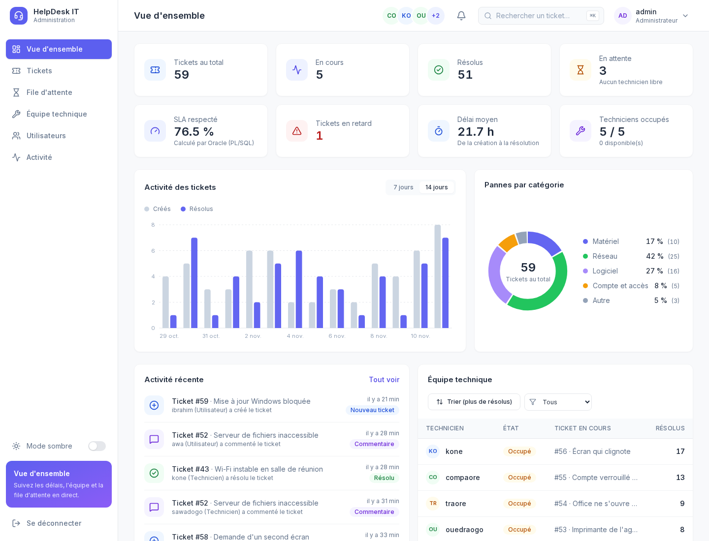
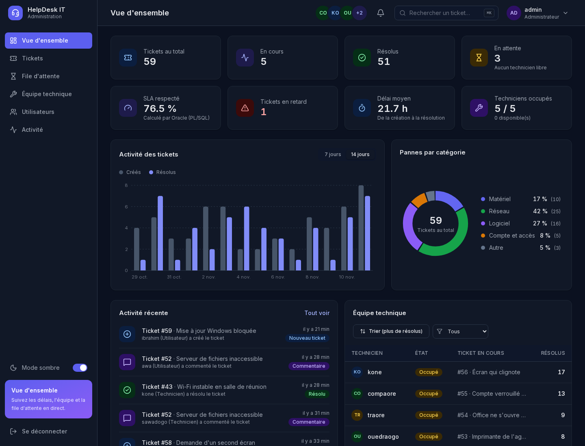
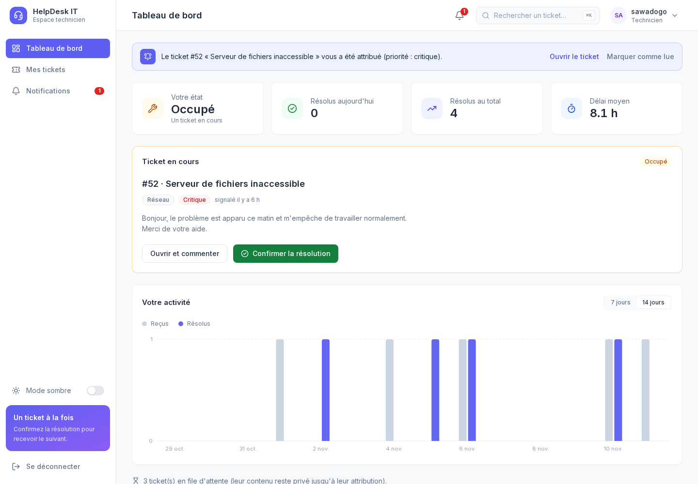
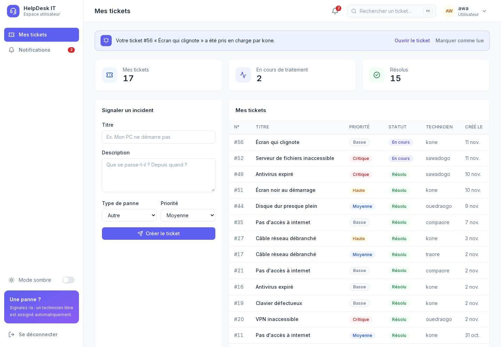
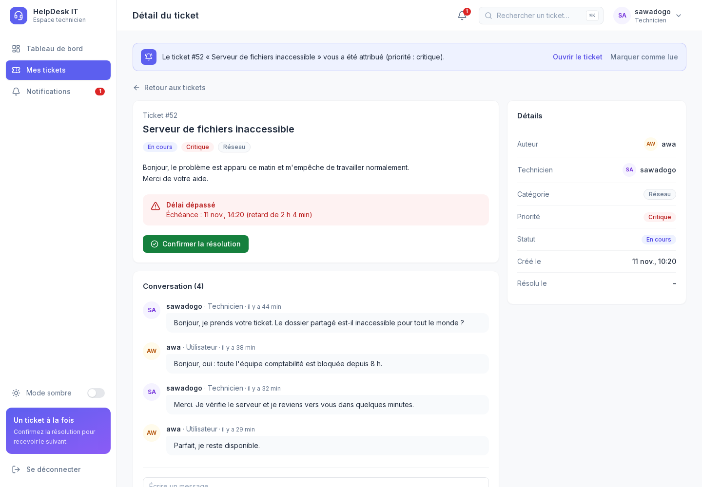
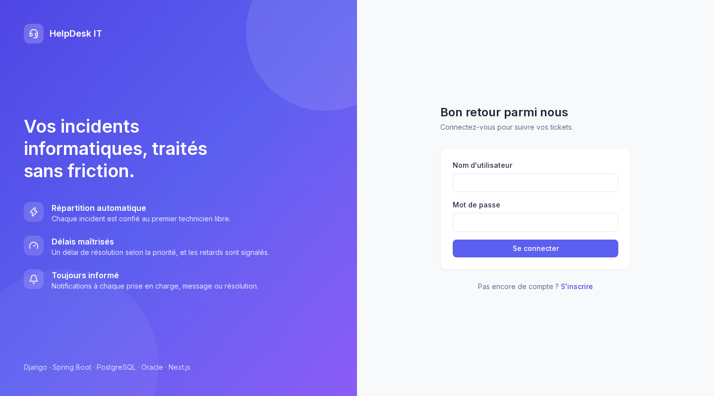
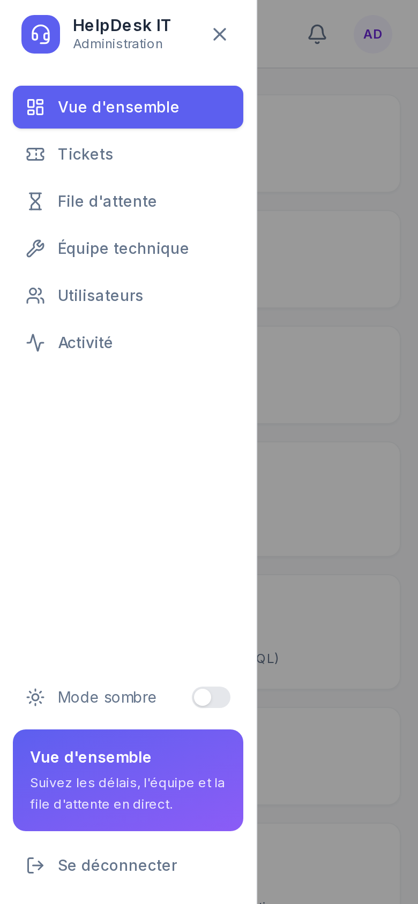
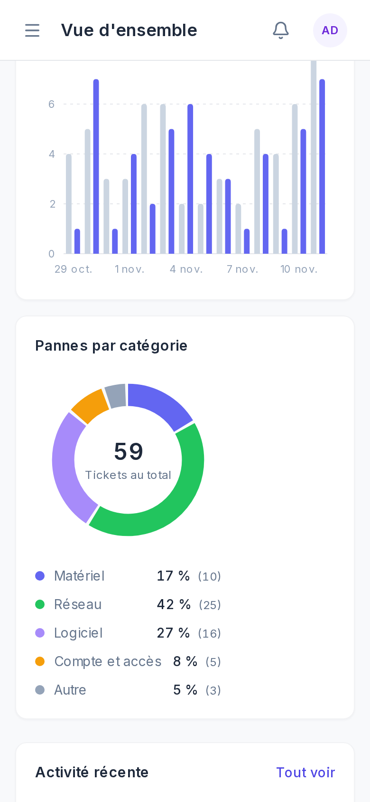
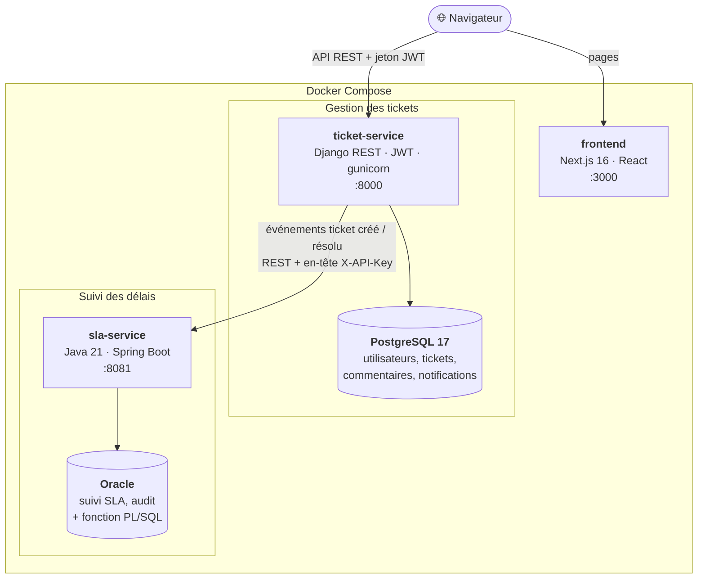

# HelpDesk IT : gestion des incidents informatiques

[](https://github.com/Bienvenu733/helpdesk-it/actions/workflows/ci.yml)


## Aperçu

Les captures ont été prises sur la pile Docker complète, avec des données de démonstration.



*Vue d'ensemble de l'administrateur : indicateurs, activité des 14 derniers jours, répartition des pannes, fil d'activité et équipe technique. Le taux de respect du SLA est calculé par une fonction PL/SQL dans Oracle.*

<table>
  <tr>
    <td width="50%">
      
      <br><sub><b>Mode sombre</b> : mémorisé, ou calqué sur le réglage du système.</sub>
    </td>
    <td width="50%">
      
      <br><sub><b>Technicien</b> : un seul ticket à la fois, notification à chaque attribution.</sub>
    </td>
  </tr>
  <tr>
    <td width="50%">
      
      <br><sub><b>Utilisateur</b> : signaler un incident et suivre ses tickets.</sub>
    </td>
    <td width="50%">
      
      <br><sub><b>Détail d'un ticket</b> : échange privé entre l'auteur et le technicien, délai SLA suivi par Spring Boot.</sub>
    </td>
  </tr>
</table>

<table>
  <tr>
    <td width="55%" valign="top">
      
      <br><sub><b>Connexion</b></sub>
    </td>
    <td width="22%" valign="top">
      
      <br><sub><b>Mobile</b> : menu</sub>
    </td>
    <td width="22%" valign="top">
      
      <br><sub><b>Mobile</b> : graphiques</sub>
    </td>
  </tr>
</table>

## Architecture

Deux services indépendants, chacun avec sa propre base, qui communiquent par une API REST protégée
par une clé. Tout démarre avec `docker compose up`.



- **ticket-service** (Django, PostgreSQL) : comptes et rôles (utilisateur, technicien, administrateur),
  tickets, répartition automatique, notifications, statistiques.
- **sla-service** (Spring Boot, Oracle) : échéance de chaque ticket selon sa priorité, détection des
  retards, piste d'audit, taux de respect du SLA calculé par une fonction PL/SQL.
- **frontend** (Next.js) : un espace par rôle.

### Conception (schémas UML)

Le détail est dans **[docs/architecture.md](docs/architecture.md)** :

| Schéma | Contenu |
|---|---|
| [Cas d'utilisation](docs/architecture.md#1-cas-dutilisation) | les trois rôles et les automatismes du système |
| [Architecture et déploiement](docs/architecture.md#2-architecture-et-déploiement) | services, bases, flux, choix de conception |
| [Diagrammes de classes](docs/architecture.md#3-diagrammes-de-classes) | modèle métier de Django et de Spring Boot |
| [Modèle relationnel](docs/architecture.md#4-modèle-relationnel-des-deux-bases) | tables PostgreSQL et Oracle, clés, suppressions en cascade |
| [Diagrammes de séquence](docs/architecture.md#5-diagrammes-de-séquence) | création d'un ticket, résolution et attribution du suivant, statistiques SLA |
| [Diagrammes d'états](docs/architecture.md#6-diagrammes-détats) | cycle de vie d'un ticket et d'un technicien |

## Règles métier
| Priorité | Délai de résolution (SLA) |
|---|---|
| Critique | 4 h |
| Haute | 8 h |
| Moyenne | 24 h |
| Basse | 72 h |

## Lancer toute l'application avec Docker

Prérequis : Docker et Docker Compose.

```bash
./scripts/make-env.sh        # crée .env avec des mots de passe et clés aléatoires
docker compose up --build
```

Au premier démarrage (2 à 3 minutes, Oracle est long à initialiser), cinq conteneurs démarrent :

| Service | Rôle | Adresse |
|---|---|---|
| `frontend` | Interface Next.js | http://localhost:3000 |
| `ticket-service` | API Django (gunicorn) | http://localhost:8000/api |
| `sla-service` | API Spring Boot | http://localhost:8081 |
| `postgres` | Base de `ticket-service` | 127.0.0.1:5432 |
| `oracle` | Base de `sla-service` | 127.0.0.1:1521 |

- Les migrations Django s'appliquent toutes seules, et la fonction PL/SQL est installée par
  `sla-service` au démarrage : une base neuve est prête sans étape manuelle.
- Avec `SEED_DEMO=true`, quatre comptes sont créés : `admin`, `technicien1`, `technicien2`,
  `utilisateur`, tous avec le mot de passe `DEMO_PASSWORD` de votre `.env`.
- Les données sont conservées dans des volumes Docker. `docker compose down` les garde ;
  `docker compose down -v` les efface.
- Les deux bases ne sont exposées que sur `127.0.0.1` (votre machine), jamais sur le réseau.
- **Aucun secret par défaut** : sans `DJANGO_SECRET_KEY`, `SLA_API_KEY` ou `DB_PASSWORD`, les services
  refusent de démarrer en production (ils ne se rabattent jamais sur une valeur publiée sur GitHub).
- Pour changer un port (ex. si 8000 est déjà pris) : `DJANGO_PORT=8100 docker compose up`.
  `PUBLIC_API_URL` est « gravée » dans l'interface à la compilation : après l'avoir changée,
  relancez avec `--build`.

## Développer sans Docker (ou avec seulement les bases)

```bash
docker compose up -d postgres oracle      # uniquement les bases

# Django : PostgreSQL dès que POSTGRES_HOST est défini, sinon SQLite
cd ticket-service
python -m venv .venv && .venv/bin/pip install -r requirements.txt
POSTGRES_HOST=localhost POSTGRES_PASSWORD=... .venv/bin/python manage.py migrate
POSTGRES_HOST=localhost POSTGRES_PASSWORD=... .venv/bin/python manage.py runserver

# Spring Boot : le profil « dev » fournit les valeurs de développement local (application-dev.properties).
# Pour l'Oracle de la pile Docker, passez plutôt DB_PASSWORD et SLA_API_KEY (valeurs de .env).
cd sla-service && SPRING_PROFILES_ACTIVE=dev ./mvnw spring-boot:run

# Interface
cd frontend && npm install && npm run dev
```

## Tests

```bash
cd ticket-service && .venv/bin/python -m pytest                      # SQLite, rapide
cd ticket-service && POSTGRES_HOST=localhost POSTGRES_PASSWORD=... .venv/bin/python -m pytest   # sur PostgreSQL
cd sla-service && ./mvnw test                                        # H2 en mémoire, sans Oracle
```

## Intégration et déploiement continus (GitHub Actions)

### Branches et flux de travail

```
 feature / correctif  ──push──▶  develop  ──pull request──▶  main  ──▶ publication des images
                                    │                           │
                              CI à chaque envoi        CI à nouveau (porte d'entrée)
```

- `develop` reçoit le code en premier : le CI vérifie chaque envoi.
- Une pull request `develop` → `main` rejoue toutes les vérifications avant la fusion.
- Seule la branche `main` publie les images Docker.
- Dependabot ouvre ses propositions vers `develop` (jamais directement vers `main`).

Le workflow `.github/workflows/ci.yml` se déclenche à chaque `push` sur `main` ou `develop`, et à chaque pull request vers l'une de ces branches :

| Job | Vérifie |
|---|---|
| **Django** (SQLite et PostgreSQL) | `manage.py check`, aucune migration oubliée, 84 tests pytest |
| **Spring Boot** | compilation et 59 tests JUnit (base H2, sans Oracle) |
| **Frontend** | ESLint, TypeScript, compilation de production |
| **Bout en bout** | démarre toute la pile Docker (avec Oracle) et rejoue `scripts/smoke_test.py` : 34 vérifications à travers les vraies API |
| **Publication** | sur `main` seulement, après succès de tout le reste : publie les 3 images dans `ghcr.io` |

Le test de bout en bout se lance aussi chez vous :

```bash
docker compose up -d --build --wait
python3 scripts/smoke_test.py
```

`.github/dependabot.yml` propose chaque semaine les mises à jour de dépendances (pip, Maven, npm,
Docker, Actions), que ce même workflow valide avant fusion.

Avant un vrai déploiement : définir la variable de dépôt `PUBLIC_API_URL` (adresse publique de l'API,
gravée dans l'image du frontend).

## Feuille de route
- [x] Service Django : tickets, rôles, répartition automatique, notifications, tableaux de bord
- [x] Service Spring Boot + Oracle : suivi SLA, audit, fonction PL/SQL
- [x] Interface Next.js (utilisateur, technicien, administrateur)
- [x] Tests automatisés (Django : pytest, Spring Boot : JUnit)
- [x] PostgreSQL et Docker Compose
- [x] CI/CD GitHub Actions (tests, test de bout en bout, publication des images)

## Licence

Distribué sous licence [MIT](LICENSE).
