# Conception de HelpDesk IT

Schémas UML du projet. Ils sont écrits en [Mermaid](https://mermaid.js.org/) : GitHub les affiche
directement et ils se versionnent avec le code.

| # | Schéma | Question à laquelle il répond |
|---|---|---|
| 1 | [Cas d'utilisation](#1-cas-dutilisation) | Qui fait quoi avec le système ? |
| 2 | [Architecture et déploiement](#2-architecture-et-déploiement) | Quels services, quelles bases, comment communiquent-ils ? |
| 3 | [Diagrammes de classes](#3-diagrammes-de-classes) | Quel est le modèle métier de chaque service ? |
| 4 | [Modèle relationnel](#4-modèle-relationnel-des-deux-bases) | Quelles tables, quelles clés ? |
| 5 | [Diagrammes de séquence](#5-diagrammes-de-séquence) | Que se passe-t-il, étape par étape, à la création et à la résolution d'un ticket ? |
| 6 | [Diagrammes d'états](#6-diagrammes-détats) | Quel est le cycle de vie d'un ticket et d'un technicien ? |

---

## 1. Cas d'utilisation

Trois acteurs humains. Le système agit aussi de lui-même (répartition, suivi des délais, audit).

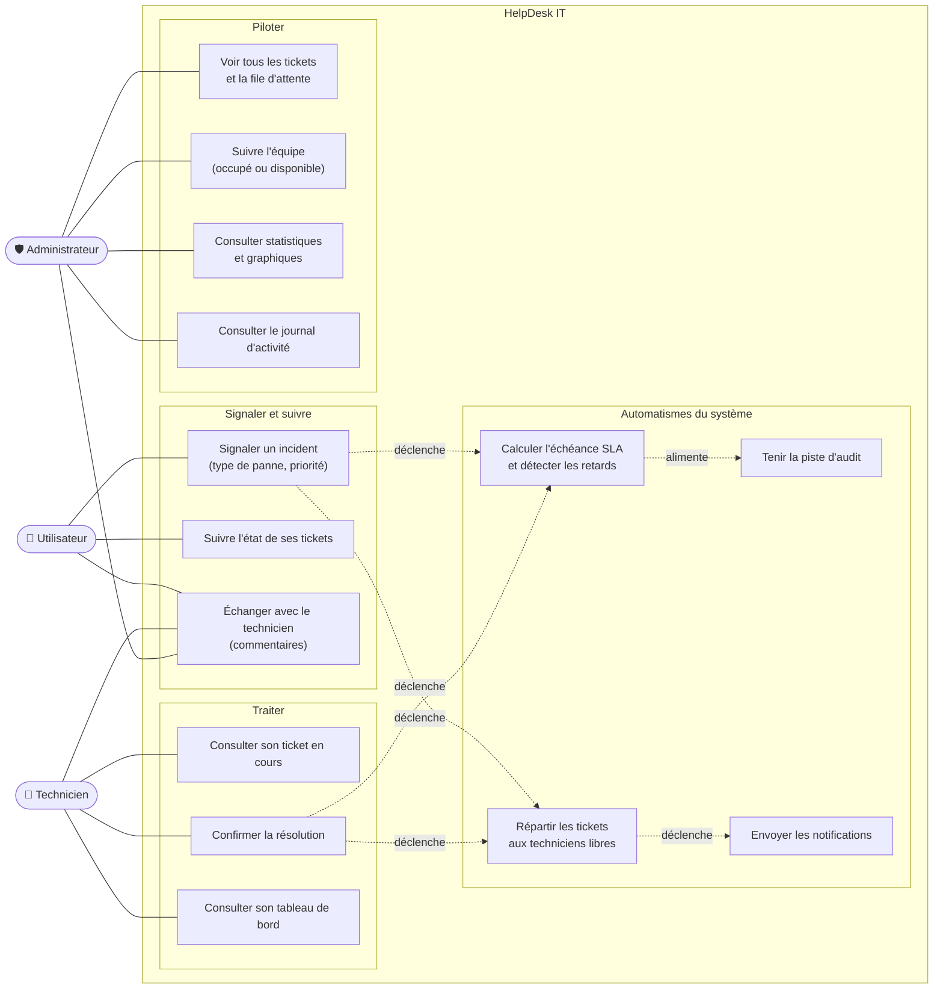

**Règles de confidentialité.** Un ticket est un échange **privé** entre son auteur et le technicien
assigné. Seul l'administrateur voit tous les tickets ; un technicien ne voit jamais ceux de ses
collègues, pas même ceux en attente.

---

## 2. Architecture et déploiement

Deux services indépendants, chacun avec **sa propre base**, qui communiquent par une API REST
protégée par une clé. Tout démarre avec `docker compose up`.

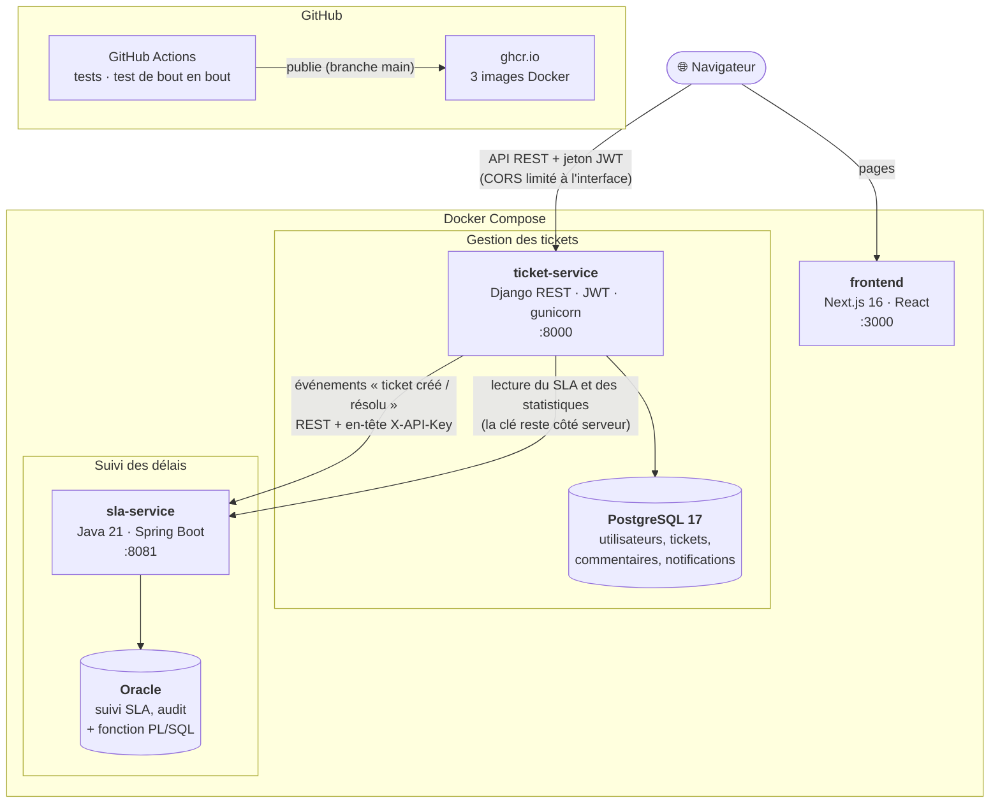

**Choix de conception.**
- Le **navigateur ne connaît jamais la clé** du service SLA : il passe par Django, qui la détient.
- Si Spring Boot est arrêté, **Django continue** : un ticket se crée quand même (seul le suivi SLA est
  momentanément absent).
- Les deux bases ne sont exposées que sur `127.0.0.1`.

---

## 3. Diagrammes de classes

### 3.1 Service Django (`ticket-service`)

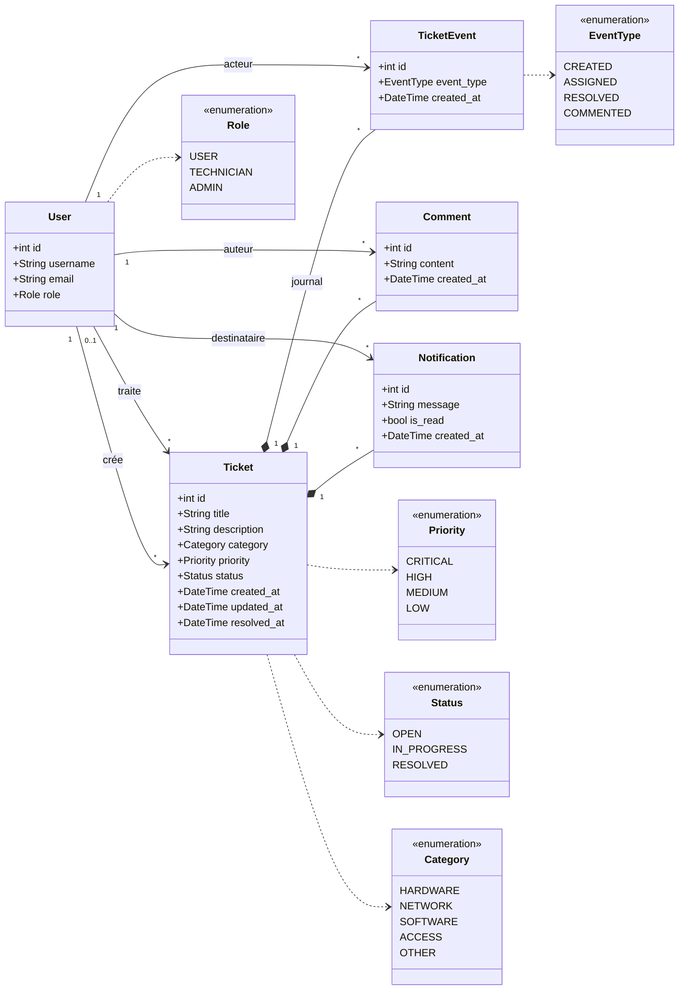

Le statut `CLOSED` existe dans le code mais n'est pas utilisé : un ticket s'arrête à `RESOLVED`.
Un ticket `OPEN` **sans technicien assigné** est « en attente » dans la file. La répartition choisit les tickets
urgents d'abord, puis les plus anciens ; chaque technicien traite un seul ticket à la fois.

### 3.2 Service Spring Boot (`sla-service`)

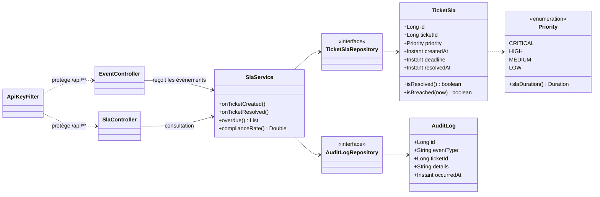

Délais par priorité (`Priority.slaDuration()`) : critique 4 h, haute 8 h, moyenne 24 h, basse 72 h.

`ticketId` est l'identifiant du ticket **côté Django** : les deux services n'ont volontairement
**aucune clé étrangère commune** (bases séparées), seulement cette référence logique.
`isBreached` compare la date de résolution (ou « maintenant » si le ticket est ouvert) à l'échéance.

---

## 4. Modèle relationnel des deux bases

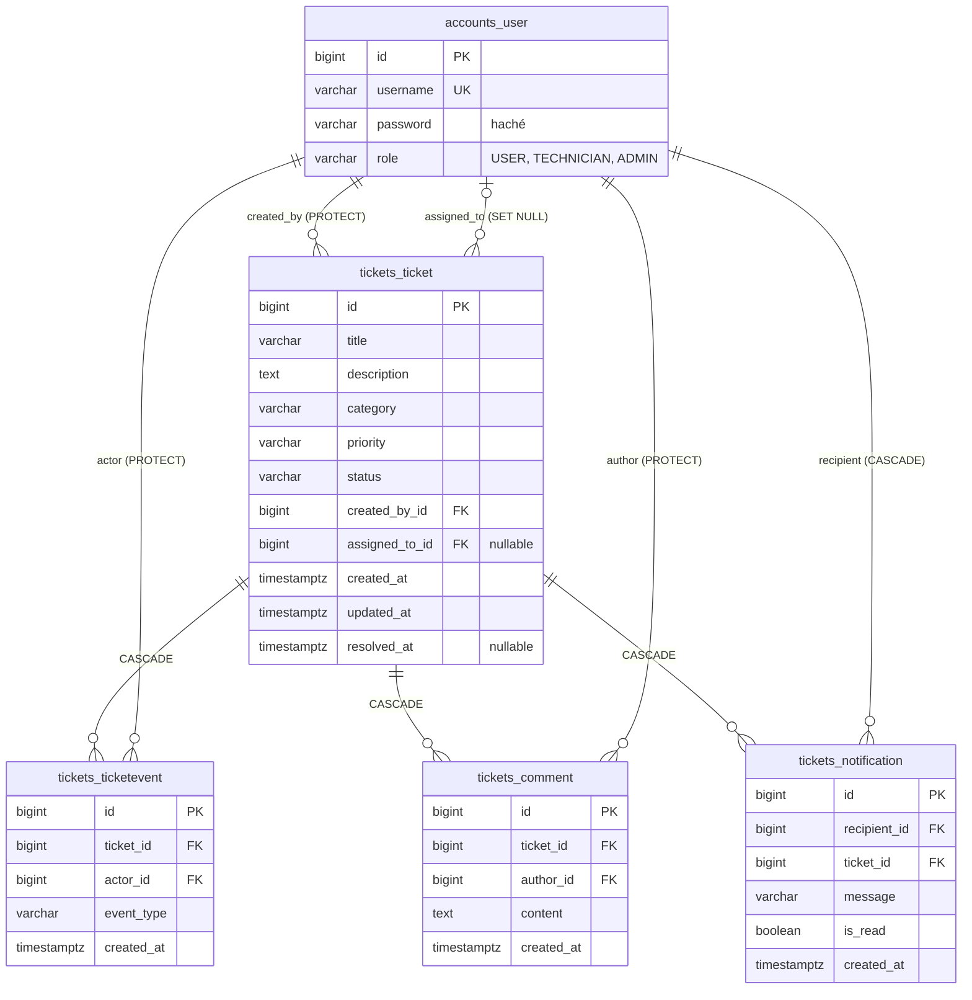

**Base PostgreSQL ci-dessus (Django).** `PROTECT` interdit de supprimer un utilisateur qui a des
tickets (historique préservé) ; `CASCADE` supprime avec le ticket ses événements, commentaires
et notifications ; `SET NULL` libère le ticket si son technicien est supprimé.

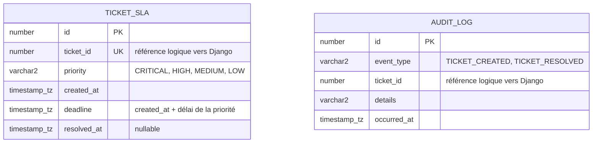

**Base Oracle ci-dessus (Spring Boot).** `timestamp_tz` désigne `TIMESTAMP(9) WITH TIME ZONE`, le type créé par Hibernate pour un `Instant` Java. `ticket_id` est unique dans `TICKET_SLA` : la base
refuse un doublon, ce qui rend la réception d'un même événement deux fois sans danger.
La fonction PL/SQL `sla_compliance_rate(priorité)` calcule le pourcentage de tickets résolus
dans les délais directement dans Oracle.

---

## 5. Diagrammes de séquence

### 5.1 Création d'un ticket

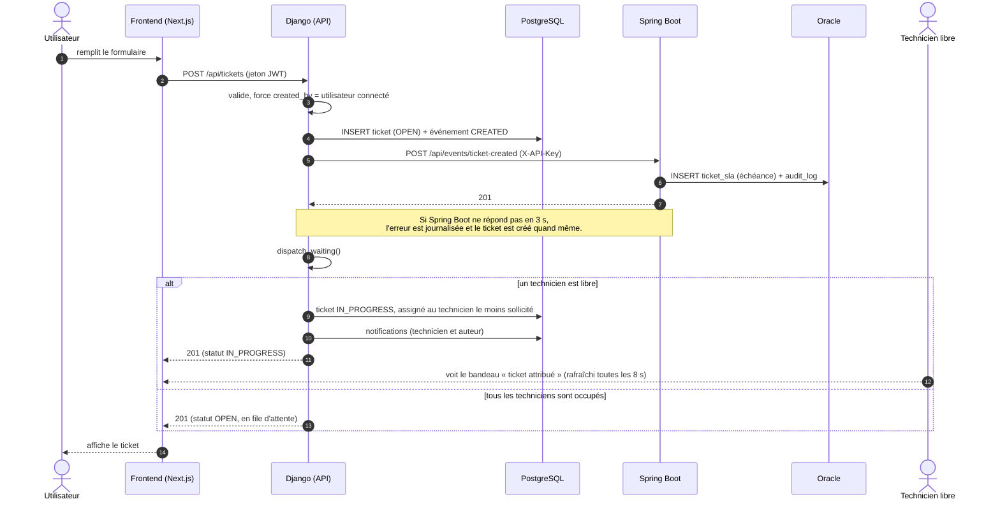

### 5.2 Résolution d'un ticket et attribution du suivant

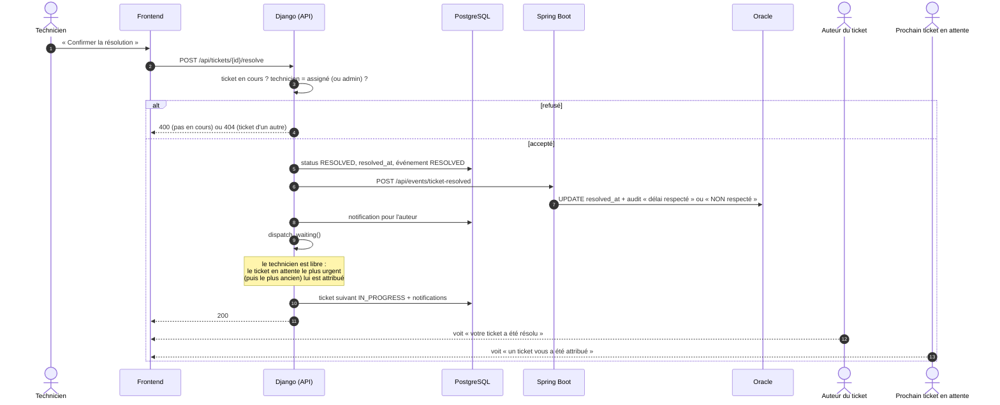

### 5.3 Consultation du taux de SLA par l'administrateur

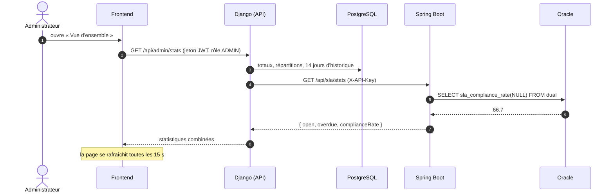

---

## 6. Diagrammes d'états

### 6.1 Cycle de vie d'un ticket

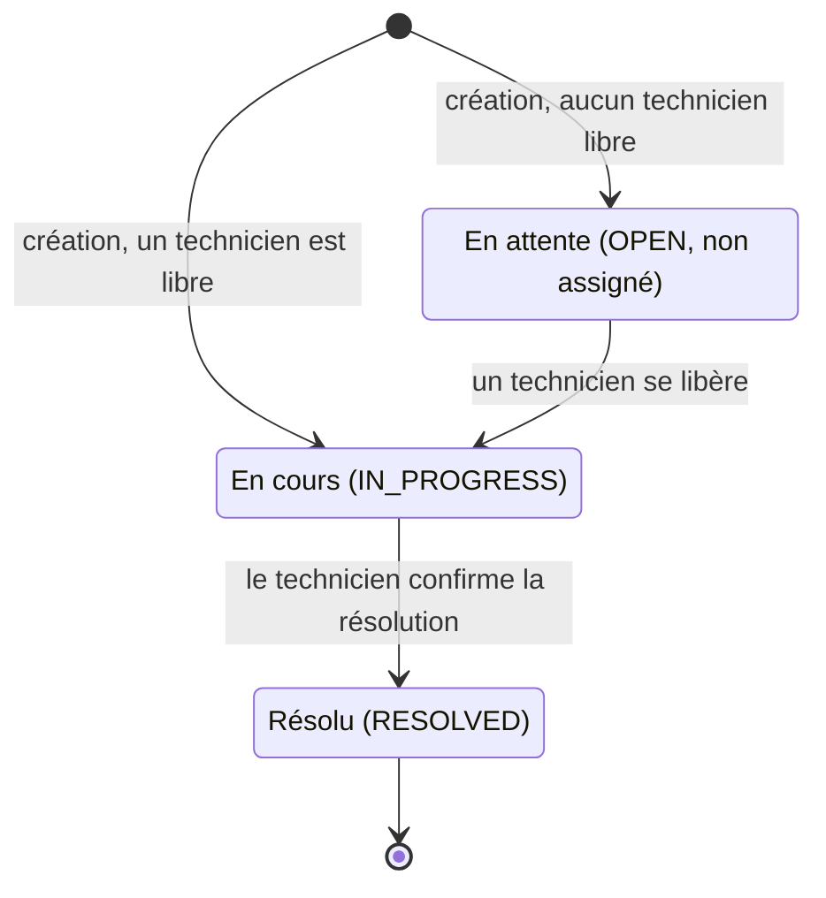

### 6.2 Disponibilité d'un technicien

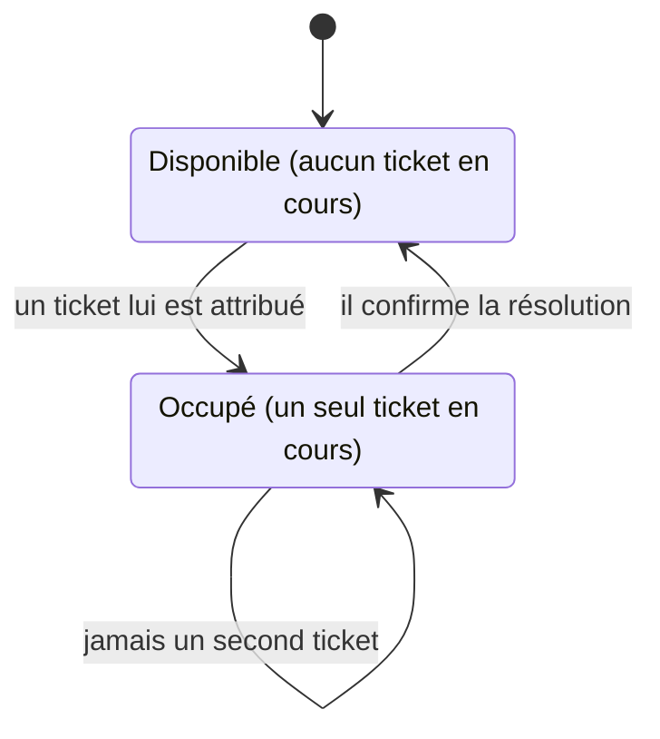
